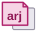
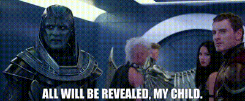

# Apocalypse Reveal-js (ARJ)



**ARJ**, Apocalypse Reveal-js: reusable scripts and styles that sit on top of [reveal.js](https://revealjs.com/) 5. Made for the SDev Tutors decks by [Mark Crowe](https://sdevtutors.github.io/mark-crowe/).

- Source: <https://github.com/SDevTutors/apocalypse-reveal-js>
- Version: 1.8.15 (year.tenth.change: year 1 is 2026, the tenth of the year 0 to 9, then one more for every change in that tenth, from 1)
- Demo: [`demo/index.html`](demo/index.html), and the same slides already printed: [`demo/src/pdf/arj-demo.pdf`](demo/src/pdf/arj-demo.pdf)
- Releases: load a fixed version in a deck (`@v1.8.9`), not the latest. How to version, tag, release on GitHub, publish to npm and serve from jsDelivr: [`docs/publishing.md`](docs/publishing.md)



> "All will be revealed" - [En Sabah Nur](https://www.imdb.com/title/tt3385516/characters/nm1209966/ "Apocalypse"), [X-Men: Apocalypse (2016)](https://www.imdb.com/title/tt3385516/ "X-Men: Apocalypse (2016)")

---

## What's in it

Everything a deck needs is in the `arj` folder: JavaScript, CSS and pictures, no documentation.

| File                                                                   | What it does                                                                                                                                     |
|------------------------------------------------------------------------|--------------------------------------------------------------------------------------------------------------------------------------------------|
| [`arj/js/deck-start.js`](arj/js/deck-start.js)                         | Starts the deck: `startDeck({...})` runs reveal.js, loads tldreveal for drawing, then loads the other scripts in order                           |
| [`arj/js/deck-markdown.js`](arj/js/deck-markdown.js)                   | For Markdown decks: classes for field lines ("**Who:** ..."), scene lines, shrinking long slides to fit, on screen and in the print version, and continuing a long list on new slides (`class="split"`) |
| [`arj/js/link-icons.js`](arj/js/link-icons.js)                         | A website's own icon beside each link, and an arrow out of a box after links that open a new tab                                                 |
| [`arj/js/deck-controls.js`](arj/js/deck-controls.js)                   | The buttons (slide list, home, contents, blackout, all slides, speaker view, full screen, exit), the slide list sidebar, the contents slides and the numbering |
| [`arj/js/deck.js`](arj/js/deck.js)                                     | The mouse (wheel, click, right click, middle click), the padlock, footnote jumps, copy buttons on code, email links, the position bar in a stack, the slide at the top of a tall window (`pinTop: true`) |
| [`arj/js/deck-draw.js`](arj/js/deck-draw.js)                           | The pen button: drawing on the slides with tldreveal                                                                                             |
| [`arj/js/deck-zoom.js`](arj/js/deck-zoom.js)                           | Click a picture to see it big, the rest dimmed                                                                                                   |
| [`arj/js/deck-search.js`](arj/js/deck-search.js)                       | The magnifying glass: searches every slide, in place of the browser's Ctrl+F                                                                     |
| [`arj/css/arj.css`](arj/css/arj.css)                                   | The theme: light slides, navy and gold, 1280 × 720. Code boxes, link icons, and the title slide (`class="title-slide arj-title"`)                |
| [`arj/css/deck-controls.css`](arj/css/deck-controls.css)               | The buttons, sidebar, contents, padlock, pen, search and exit, and the PDF icon on print and PDF links                                           |
| [`arj/img/arj-logo.svg`](arj/img/arj-logo.svg)                         | The ARJ logo (`tap-logo.png` is the old one)                                                                                                     |
| [`arj/img/favicons/`](arj/img/favicons/)                               | ARJ's own two website icons, reveal.js and GitHub, drawn by `arj.css` ("Icons"). A deck keeps any others itself, with its own CSS              |
| [`arj/img/meme/expanding-brain.jpg`](arj/img/meme/expanding-brain.jpg) | The expanding brain meme, for the theme's `.brain` layout                                                                                        |

---

## Using it in a presentation

### With a copy of the folder

Copy `arj` next to your HTML file:

```html
<head>
  <link rel="stylesheet" href="https://cdn.jsdelivr.net/npm/reveal.js@5.1.0/dist/reset.css" />
  <link rel="stylesheet" href="https://cdn.jsdelivr.net/npm/reveal.js@5.1.0/dist/reveal.css" />
  <link rel="stylesheet" href="arj/css/arj.css" />
  <link rel="stylesheet" href="arj/css/deck-controls.css" />
</head>
<body>
  <div class="reveal"><div class="slides"> ... </div></div>
  <script src="https://cdn.jsdelivr.net/npm/reveal.js@5.1.0/dist/reveal.js"></script>
  <script src="arj/js/deck-start.js"></script>
  <script>
    startDeck({
      width: 1280, height: 720,      // any reveal.js setting
      mouseWheel: false,             // deck.js handles the wheel
      scrollActivationWidth: null,   // keep the slides on a phone (tldreveal needs this)
      lock: true,                    // the padlock
      draw: true,                    // the pen (the default)
      drawToolbar: 'top',            // tldraw's tools at the top centre (or 'bottom')
      drawOnDoubleClick: false,      // a double click selects a word, not opens drawing
      linkIcons: { newTab: true },   // links to other websites open in a new tab
      deckControls: { exit: true },  // the exit button (the default)
      deckScripts: ['link-icons.js', 'deck-controls.js', 'deck.js', 'deck-draw.js'],
    });
  </script>
</body>
```

A script named without a folder (`'deck.js'`) is loaded from the folder `deck-start.js` came from, so the page only names that one file. Order matters: `deck-markdown.js` first (for Markdown decks), then `link-icons.js`, `deck-controls.js`, `deck.js`, and `deck-draw.js` last.

### From the hosted copy

The same, with the hosted addresses in place of `arj/...`. [jsDelivr](https://www.jsdelivr.com/) serves the files straight from this repository:

```html
<link rel="stylesheet" href="https://cdn.jsdelivr.net/gh/SDevTutors/apocalypse-reveal-js@master/arj/css/arj.css" />
<link rel="stylesheet" href="https://cdn.jsdelivr.net/gh/SDevTutors/apocalypse-reveal-js@master/arj/css/deck-controls.css" />
...
<script src="https://cdn.jsdelivr.net/gh/SDevTutors/apocalypse-reveal-js@master/arj/js/deck-start.js"></script>
```

`deck-start.js` loads the scripts in `deckScripts` from the same address, so the deck doesn't name them. Every file is at `https://cdn.jsdelivr.net/gh/SDevTutors/apocalypse-reveal-js@master/` followed by its path in the table above (checked 31 October 2026).

`@master` is the latest version: it changes when this repository does, and jsDelivr can take up to a week to catch up. Once a version is tagged (`v1.8.6`, say), `@v1.8.6` in place of `@master` is a fixed address that never changes. Tagging, GitHub releases, the npm package and a git-ignored copy in a deck: [`docs/publishing.md`](docs/publishing.md).

---

## The padlock (`lock: true`)

A padlock at the top right, beside the other buttons.

- **Locked** (the start): the mouse moves through the slides. Left click on empty space is next, right click is back, the wheel steps one slide. Text can't be selected and there is no context menu, so nothing gets selected by accident.
- **Unlocked**: select and copy text; the context menu works. The mouse doesn't change slides: no click, wheel or mouse-button navigation. The keyboard, reveal.js's arrows and the buttons still do.

Either way, links, buttons, copy icons, the stack bars, the footnote markers and reveal.js's controls work. Without `lock: true` a deck behaves as before: the mouse moves the slides and text can be selected.

---

## Drawing (tldreveal)

Drawing uses [tldreveal](https://github.com/arthurrump/tldreveal) by Arthur Rump ([demo](https://arthurrump.github.io/tldreveal/)), which puts [tldraw](https://tldraw.com) over the slides. It's part of ARJ: `startDeck` loads tldreveal 1.2.0 (its bundle, with React and tldraw) from jsDelivr and adds it to the plugins before reveal.js starts. A deck doesn't need its own `<script>` for it.

| Action                    | How                                             |
|---------------------------|-------------------------------------------------|
| Open drawing              | The pen button, or D                            |
| Close drawing             | The pen button again, or Esc. The drawings stay |
| Hide or show the drawings | V (tldreveal's key)                             |

- Each slide keeps its own drawings; they come back with the slide.
- tldraw's tools are at the top centre (`drawToolbar: 'top'`), clear of the slide number, on one row: tldraw's compact layout puts undo, redo and the actions above the tools, and ARJ puts them side by side (two rows again only in a window too narrow for both). `drawToolbar: 'bottom'` puts them back where tldreveal has them.
- With `pinTop`, the drawing area moves up with the slide, so at any window size it covers the slide exactly (tldreveal centres it in the window, as reveal.js does the slide).
- Only the slide can be drawn on, not the margins round it, the buttons or the slide number. While drawing, everything outside the slide is shaded grey, with a gold line round the slide, so you can see where the edge is.
- While drawing, the mouse belongs to tldraw: `deck.js` doesn't change slides on a click or the wheel, whether locked or not. The padlock keeps its setting for when drawing closes.
- The pen button only appears when tldreveal has loaded. With `draw: false`, offline, in the print version or in reveal.js's scroll view, there's no button and nothing is loaded.
- Settings for tldreveal go in `tldreveal: { ... }` in `startDeck` (see tldreveal's `config.ts`). ARJ sets `isDarkMode: false` for the light theme.

**Limitations**  

- tldreveal has no API to open or close drawing, so ARJ presses its keys for it (D to open, Esc to close).
- tldreveal opens drawing on any double click. ARJ turns that off (`drawOnDoubleClick: false`, the default), so a double click still selects a word when the deck is unlocked. If a double click opens drawing anyway, ARJ closes it again straight away.
- tldraw only draws on the slide: tldreveal fixes its canvas to the slide's size, so drawing can't reach the margins.
- The arrow keys still move between slides while drawing, and the drawings follow (that's tldreveal's design). Every other key goes to tldraw: reveal.js only gets the arrows and Page Up/Down, so O, F and B pick tldraw's tools instead of opening the overview, full screen or blackout.
- Drawings last until the page is reloaded. tldreveal can save them in the browser if the `.reveal` element has an `id` or `data-tlid`; ARJ doesn't set one yet.
- The bundle is about 1.2 MB, and it comes from the internet.
- tldreveal is under the Mozilla Public License 2.0, but tldraw, which it uses, has its own licence: [non-commercial use](https://github.com/tldraw/tldraw/blob/main/LICENSE.md) only.

### Chalkboard features

These features in the [reveal.js Chalkboard](https://github.com/rajgoel/reveal.js-plugins/tree/master/chalkboard) demonstration were checked against tldreveal.

| Feature                                            | In tldreveal?          | Where it comes from                                                                                               |
|----------------------------------------------------|------------------------|-------------------------------------------------------------------------------------------------------------------|
| Playback: playing through the slides automatically | No                     | rajgoel's separate audio-slideshow plugin; reveal.js's own `autoSlide` setting can step through slides on a timer |
| Playback speed, the five-second interval           | No                     | audio-slideshow's `defaultDuration` (5 seconds); `autoSlide: 5000` in reveal.js                                   |
| Mute and unmute                                    | No                     | audio-slideshow (it plays recorded audio); nothing to mute without it                                             |
| Replaying drawings stroke by stroke                | No                     | Chalkboard records strokes with timings; tldraw keeps only the finished drawing                                   |
| PDF and printing                                   | Yes, through reveal.js | reveal.js's own print version (`?print-pdf`), used as it is                                                       |

A playback button using reveal.js's `autoSlide` (play, pause, speed) could be added to ARJ. Replaying drawings and audio would need audio-slideshow or new work.

---

## Search

The browser's own find (Ctrl+F) only sees the slide on the screen, and the slide list if it's open. [`deck-search.js`](arj/js/deck-search.js) searches every slide instead: the magnifying glass, first of the top right buttons, or Ctrl+F (Cmd+F on a Mac), which it takes over from the browser.

- It searches as you type, and counts the finds: "3 of 41".
- Enter, Down or F3 goes to the next find, on whichever slide it is (and on to its fragment, if that hasn't appeared yet); Shift+Enter, Up or Shift+F3 to the one before. The arrows beside the count do the same.
- Every find is marked in yellow, the current one in orange; the slides themselves don't change (the browser's highlight API).
- Each line with a find is listed with its slide, as in Word's navigation pane: in the slide list, in place of the slides (it opens while you search, and closes again after if it was closed), or under the box when there's no slide list or the window is narrow. Click a line to go to it.
- Esc or the cross closes it; the marks go and you stay on the slide you're on.

It searches the slides' text, not the speaker notes or the contents slides. Capitals don't matter, and a space matches any space or line break. Settings in `startDeck`: `search: false` leaves it out (Ctrl+F is the browser's again), `searchList: 'box'` lists the lines under the box, `searchList: false` doesn't list them. Mark anything it should skip with `class="no-search"`. Add `'deck-search.js'` to `deckScripts`, after `deck-draw.js` (and `'deck-zoom.js'` for picture zoom).

---

## Exit

The last button at the top right leaves the slides (`deckControls: { exit: true }`, the default):

- It goes to the exit slide, the last one: the slide with `id="exit"` (`exitSlide`), with a big button on it, `<button type="button" data-deck-exit>Click here to exit</button>`. On the exit slide, or in a deck without one, the exit button does what the big button does.
- The big button goes back to the page before the slides, however many slides you've been through (with `history: true` each slide is a step in the browser's history, so the browser's Back button only goes back one slide). It finds where the slides start in the browser's own list of pages (the Navigation API), so it still works after a reload.
- With no page before them (a tab of their own), it closes the tab. Browsers only let a page close a tab that a script opened, so if the tab is still open a moment later it opens `home` (`deckControls: { home: '../../' }`, the list of decks), or else the page that linked to the slides. The browser's history is never changed, only gone back through.
- `exit: 'index.html'` always goes to that page; `exit: false` leaves the button out.

## Speaker view

With reveal.js's notes plugin (`plugins: [RevealNotes]`), a button at the top right opens the speaker view, the same as the S key: the notes, a timer, and the next slide. For a phone or tablet with no keyboard. `deckControls: { speakerView: false }` leaves it out.

## Picture zoom

[`deck-zoom.js`](arj/js/deck-zoom.js): click a picture and it fills the screen, all of it (the slide may show it small, or cropped to fit), with the rest dimmed and its caption under it. A click anywhere, or Esc, puts it back. It's one picture, not a slideshow. By default it works on a topic slide's picture (`figure.topic-photo img`), the title slide's QR code (bigger, so it scans from the back of the room; it isn't a link) and any picture with `class="zoom"`; `zoom: { pictures: '...' }` names others, `zoom: false` turns it off. A picture inside a link stays a link.

---

## Links

[`link-icons.js`](arj/js/link-icons.js) puts a website's own icon before each link: the icon, the link, then the new-tab arrow. Which icon is CSS, so no page names an icon's address and nothing changes when ARJ moves (GitHub Pages, jsDelivr, a local copy). ARJ has reveal.js, GitHub and a folder (`<a class="folder">`), in [`arj/css/arj.css`](arj/css/arj.css) under "Icons". Any other site's icon belongs to the deck: keep it in the deck's own folder and add a line to the deck's CSS, the address relative to that CSS file:

```css
.reveal a[href*="wikipedia.org"]::before { background-image: url("../img/favicons/wikipedia.png"); }
```

Put the address in `background-image` itself, not in a CSS variable: browsers read a relative address in a variable from the file that uses the variable (arj.css), not the one that sets it. The same goes for icons in a line of text, such as the title slide's "Built with": `<span class="arj-icon arj-icon-revealjs"></span>` (also `arj-icon-github`, `arj-icon-arj`, `arj-icon-folder`), never an `` with ARJ's address.

A site with no icon gets a plain link icon. With `linkIcons: { newTab: true }` links to other websites open in a new tab, so the slides stay open; any link that opens a new tab gets an arrow out of a box after it. A link marked `class="ext"` by hand gets the same arrow.

---

## Title slide

`<section class="title-slide arj-title">` lays out a title slide like the demo's: the title centred with a gold bar, a big QR code on the right level with the top of the subtitle's letters, and beside it, centred and smaller each time, the subtitle (`h3`), the name (`p.byline`), the date (a second `p.byline`), a short quote if you like (`p.title-quote`) and "Built with". A small footer: on its line "Download as PDF" on the left (`p.deck-pdf`), the copyright in the middle (`p.footer-rights`) and the version on the right (`p.deck-version-line`); under the line a short address to type in on the left (`<p class="deck-short"><a href="..." data-tip="..." data-tip-size="72">`: hover shows it big, and the big one is clickable too) and the deck's own address on the right (`p.deck-url`). Leave out any you don't need. See [`demo/index.html`](demo/index.html) for the HTML.

`arj.css` also has a topic slide's picture (`<figure class="topic-photo">`, 16:9 with a caption), the last slide before the exit (`<section class="finish-slide">` with a big `p.finish-questions`) and the exit slide (`p.exit-now` round the button, `p.exit-note` under it). The QR code is just the code, with no white margin:

```py
qr_logo.py URL LOGO.png OUT.svg --border 0 # in the meme bank's tools makes one.
```

---

## PDF and printing

reveal.js makes the print version: add `?print-pdf` to the address, then print and choose Save as PDF. A link to it, best on the last slide:

```html
<a href="?print-pdf" target="_blank">Print version</a>, then Save as PDF
```

Better still, print it once and keep the PDF with the deck (the demo's is in `demo/src/pdf/`), so people can download it:

```html
<a href="src/pdf/arj-demo.pdf" download>Download the PDF</a>
```

[`deck-controls.css`](arj/css/deck-controls.css) puts a red PDF icon before any `href="?print-pdf"` link and any link to a `.pdf` file. In the print version, [`deck-markdown.js`](arj/js/deck-markdown.js) shrinks each long slide to fit its page (not a title slide, `.arj-title`, or one marked `no-fit`), and the padlock and pen aren't shown.

---

## Versions

- reveal.js 5.1.0
- tldreveal 1.2.0

---

## Tools

| Command                           | What it does                                                                                       |
|-----------------------------------|----------------------------------------------------------------------------------------------------|
| `python tools/serve.py`           | Serves this repository at <http://localhost:8008/>: the demo is at `/demo/`                        |
| `python tools/version.py --write` | One more change: the new version in `deck-start.js`, `package.json`, the demo and this readme       |
| `python tools/build_pdf.py`       | Rebuilds [`demo/src/pdf/arj-demo.pdf`](demo/src/pdf/arj-demo.pdf) from the demo's print version. Needs Node 22+ and Edge or Chrome |
| `python tools/release.py`         | Shows what would be released, as the version in `package.json`; `--github` (or `release.cmd`) pushes, tags and makes the GitHub release: [`docs/publishing.md`](docs/publishing.md) |
| `python tools/commit.py`          | `version.py --write`, then a commit on this computer named by the version alone ("1.8.9"); `--pdf` rebuilds the PDF first. Never pushes: amend or undo it first if you like (`git reset --soft HEAD~1`), then push |
